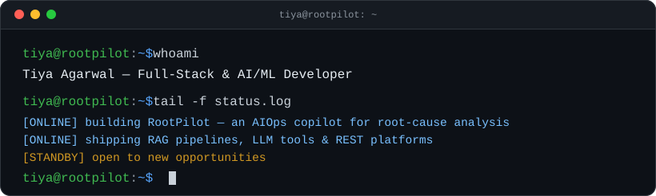

<div align="center">



📍 Vellore, India&nbsp;&nbsp;·&nbsp;&nbsp;🎓 B.Tech CS, VIT (2023–2027)

<p>
<a href="https://tiya-agarwal-portfolio.vercel.app/"></a>
<a href="https://www.linkedin.com/in/tiyaagarwal/"></a>
<a href="https://leetcode.com/u/tiyaagarwal04/"></a>
<a href="mailto:tiya.agarwal04@gmail.com"></a>
</p>

</div>

---

### About

Computer Science undergrad specializing in full-stack and AI/ML application development — architecting RAG pipelines, LLM-integrated tools, and REST API-driven platforms end-to-end.

- 🔭 Currently building **[RootPilot](https://github.com/tiyaagarwal/RootPilot)** — an AIOps observability platform with a GenAI root-cause copilot
- 🌱 Deep in RAG cost/latency optimization — semantic caching, routing, context compression
- 💡 200+ DSA problems solved · 8+ shipped projects across hackathons, internships, and coursework
- 🛡️ Also dabble in offensive security — VAPT assessments with real CVSS-scored findings

### Experience

<table>
<tr>
<td width="50%" valign="top">

**Software Engineering Intern**
DeepFold Technologies · *May–Jul 2026*
API contract testing, JS/SQL bug fixes, and QA documentation across enterprise modules

</td>
<td width="50%" valign="top">

**Software & IT Solutions Intern**
Elegant Soft Solutions & Services · *May–Jul 2025*
Data-integrity validation and reporting for a large-scale ERP (TallyPrime) migration

</td>
</tr>
</table>

### 📟 Build Log

|  | project | stack | what it does |
|:---:|:---|:---|:---|
| 🟢 | **[RootPilot](https://github.com/tiyaagarwal/RootPilot)** | Spring Boot · React/TS · Redis · RabbitMQ · Gemini | AIOps observability platform — anomaly detection, incident tracking, and a GenAI copilot for root-cause analysis |
| 🟢 | **[Sagevault](https://github.com/tiyaagarwal/Sagevault)** | Node/Express · MongoDB · React · LangChain · FAISS | Knowledge platform answering questions over uploaded documents via grounded RAG retrieval |
| 🟢 | **[MockMate](https://github.com/tiyaagarwal/MockMate)** | FastAPI · React · Gemini · Vertex AI · AWS S3 | AI mock-interview platform — role-specific questions, video responses, AI-scored feedback |
| 🟢 | **[raglean](https://github.com/tiyaagarwal/raglean)** | FastAPI · FAISS · sentence-transformers | Cost/latency proxy for RAG pipelines — 91% cost ↓, 71% latency ↓ in eval |
| 🟢 | **[Anemia-Sense](https://github.com/tiyaagarwal/Anemia-Sense)** | Python · scikit-learn · Flask · SHAP | Classifies anemia type from CBC panel data — 99.6% accuracy across 9 classes |
| 🟢 | **[RepGuard](https://github.com/tiyaagarwal/RepGuard)** | ESP32 · MPU6050 · scikit-learn | Wearable gym-form corrector, on-device inference, no ML runtime |
| 🔓 | **[notevault-vapt-assessment](https://github.com/tiyaagarwal/notevault-vapt-assessment)** | Burp Suite · Postman | Black-box VAPT — 10 findings (SQLi, XSS, IDOR), CVSS scoring, PoCs, remediated retest |

### ⚙️ stack.yaml

```yaml
languages:  [Python, TypeScript, Java, JavaScript, SQL]
ai_ml:      [Gemini, LangChain, scikit-learn, FAISS]
web:        [React, Spring Boot, FastAPI, Node.js, Express]
data_infra: [PostgreSQL, MongoDB, Redis, RabbitMQ, Docker, AWS]
security:   [Burp Suite, Postman]
```

### 📊 GitHub Stats

<div align="center">


</div>

### 🏆 Achievements & Certifications

- **AWS Certified Cloud Practitioner** (CLF-C02) — 2026
- 200+ DSA problems solved on LeetCode · 4+ hackathons across India
- **Core Member**, IEEE Computer Society — led AI/ML sessions for 50+ members
- **Public Relations Head**, VIT Dance Team

---

<div align="center">

🟢 profile status: online&nbsp;&nbsp;·&nbsp;&nbsp;🟢 last deploy: passing&nbsp;&nbsp;·&nbsp;&nbsp;🕐 uptime: since 2023

📫 [tiya.agarwal04@gmail.com](mailto:tiya.agarwal04@gmail.com) · [Portfolio](https://tiya-agarwal-portfolio.vercel.app/)

</div>
